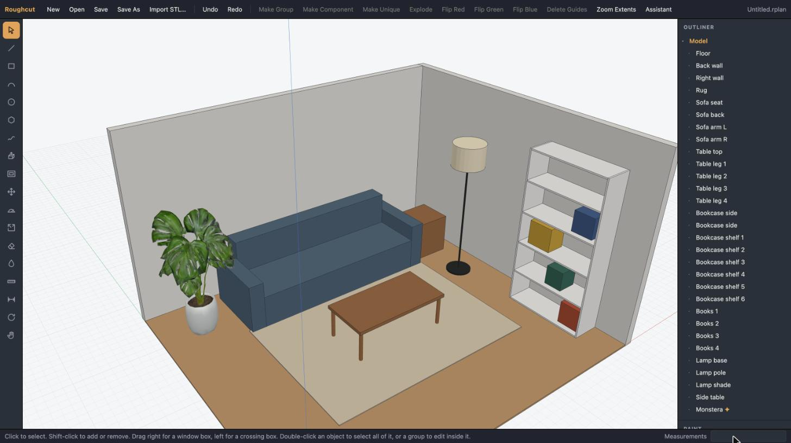

# Roughcut

**Rough out your room, then build it.** Friendly 3D modelling for planning rooms and designing
woodwork: draw lines and faces, Push/Pull them into solids, snap to what's already there, and type
exact measurements as you go. Ask the built-in assistant to lay things out for you, or to make a
realistic 3D model of anything from a sentence. Everything runs on your own machine in the browser:
no account, no hosting. See [SPEC.md](SPEC.md) for the full feature list and shortcuts.



## Status

Working today: everything in [SPEC.md](SPEC.md)'s M1 milestone (drawing tools, Push/Pull, inference
snapping, typed measurements, groups, outliner, dimensions, mm/imperial, save/load, autosave,
undo), plus components and STL import from M2, the assistant and AI props below.

Planned, not built yet: tags, textures, `.dae` export, and the v2 cut list.

## Requirements

- Node 20.19+ or 22.12+ (what Vite 8 needs).
- A Chrome-family browser (Chrome, Edge, Arc, Brave). Cmd+S saves back to the same file through
  the File System Access API; other browsers download a copy instead.
- Optional: Claude Code 2.1.326+ for the assistant, and AssetFurnace for AI props (below), which wants an
  Apple Silicon Mac (32 GB memory recommended) or a Linux PC with an NVIDIA card (24 GB tested) or AMD card (ROCm),
  plus disk for the weights: about 22 GB (8.4 GB for Pixal3D, 13.4 GB for Qwen-Image).

## Run it

```bash
npm install
npm run dev     # then open http://localhost:5173
npm test
```

Your model autosaves to browser storage; Cmd+S saves it to a `.rplan` file.

Keep the dev server on localhost (don't pass `--host`): the assistant below runs on your own
Claude login, and anyone who can reach the server could use it.

## Assistant (optional)

The chat panel talks to [Claude Code](https://claude.com/claude-code) through the dev server,
running `claude -p` with all of its tools turned off. Without it the rest of the app works as
normal. To set it up ([install guide](https://docs.anthropic.com/en/docs/claude-code/setup)):

```bash
npm install -g @anthropic-ai/claude-code
claude          # once, to log in; then quit it
```

Tested with Claude Code 2.1.326. Older versions may lack flags the bridge uses
(`--system-prompt-file`, `--tools`, `--setting-sources`).

## AI-generated 3D props (optional)

Ask the assistant for "a 3D model of an armchair" (or a monstera, a box of water bottles…) and it
places a box at the right size straight away, then swaps in a textured 3D model once one has been
made. Models are made entirely on your machine by
[AssetFurnace](https://github.com/Bingeljell/image-to-3dlab) (formerly Image to 3D Lab), using
three of its own tools:

1. **Picture**: Qwen-Image 2.1 draws the object from your words.
2. **3D**: Pixal3D turns the picture into a textured model.
3. **Finish**: the model is cut to about 4,000 faces with small textures, so a room full of
   them stays quick.

Hunyuan3D is deliberately never used: its licence excludes the UK, the EU and South Korea.

### Setting it up

1. Install AssetFurnace (Apple Silicon Mac, or Linux with an NVIDIA or AMD card). Read
   [its installer](https://assetfurnace.com/install.sh) first, then:

   ```bash
   curl -fsSL https://assetfurnace.com/install.sh | bash -s -- --ref v0.4.1
   ```

   `--ref v0.4.1` installs the release this app was tested with, since `tools/make_prop.py` uses
   AssetFurnace's internal Python API; any other version logs a warning in `props/<id>/log.txt`. It installs to `~/image-to-3dlab` (the installer's default; `--dir` changes it). If you put it elsewhere, set `ASSETFURNACE=/path/to/it`
   before `npm run dev`.
2. The installer downloads no model weights. Open AssetFurnace's **Setup & Status** page and set
   up **Pixal3D** (about 8.4 GB) and the **Qwen-Image** text-to-image model. It states each
   download's size and licence and asks first.
3. Restart `npm run dev`. That's all: the app calls `tools/make_prop.py` with AssetFurnace's own
   Python whenever the assistant asks for a model.

### How it behaves

- One model is made at a time, since each one uses the whole GPU. A typical object takes about
  10 minutes on an Apple Silicon Mac, up to 30 for big boxy ones.
- Identical requests share one model: ten copies of the same prompt are made once.
- Each finished model is stretched to fill the box it replaces, turned a quarter if that fits better.
- Results go in `props/<id>/` (gitignored): `prop.glb`, the source picture, a log, and
  AssetFurnace's record of the licences behind the file.
- To pause the queue, write a Unix time into `props/.paused-until`; jobs wait until then before
  starting. Delete the file to resume straight away.

Check those licence records before you share generated models. Pixal3D's code and weights are
MIT, its bundled image encoder is under the DINOv3 License, and Qwen says the pictures you make
are yours.

## Licence

MIT, see [LICENSE](LICENSE). AssetFurnace and the models it runs have their own licences.
